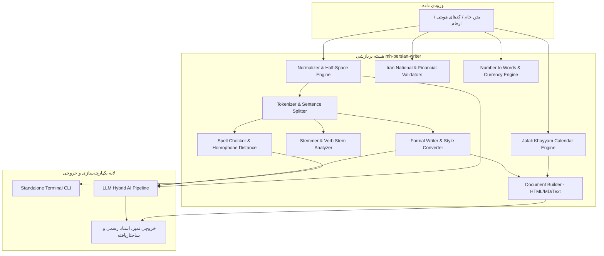

<div align="center">

# 🖋️ mh-persian-writer
### موتور جامع، فوق‌سریع و مدرن پردازش زبان، نوشتار اداری و هوش مصنوعی فارسی
**The Universal, High-Performance Persian NLP, Administrative Writing & LLM Engine for TypeScript & JavaScript**

[](https://www.npmjs.com/package/mh-persian-writer)
[](https://github.com/mhnadali/mh-persian-writer/actions)
[](https://www.typescriptlang.org/)
[](#-why-mh-persian-writer)
[](https://opensource.org/licenses/MIT)
[](#-contributing)

<p align="center">
  <a href="#-ویژگی‌های-برجسته">ویژگی‌ها</a> •
  <a href="#-نصب-و-راه‌اندازی">نصب</a> •
  <a href="#-شروع-سریع-quick-start">شروع سریع</a> •
  <a href="#-معماری-سیستم">معماری</a> •
  <a href="#-راهنمای-ماژول‌ها">ماژول‌ها</a> •
  <a href="#-ابزار-خط-فرمان-cli">خط فرمان CLI</a> •
  <a href="#-پایپ‌لاین-هیبریدی-llm">هوش مصنوعی (LLM)</a> •
  <a href="#-جدول-مقایسه">مقایسه</a>
</p>

</div>

---

## 🌟 چرا mh-persian-writer؟ (Why mh-persian-writer?)

در توسعه سامانه‌های نرم‌افزاری مدرن، پورتال‌های سازمانی، ربات‌های مکالمه و پایپ‌لاین‌های هوش مصنوعی (LLMs)، زبان فارسی با چالش‌های فنی متعددی مواجه است: کاراکترهای غیراستاندارد عربی، ناهماهنگی در درج نیم‌فاصله (ZWNJ)، ساختارهای غیررسمی و شکسته، پیچیدگی جمع‌های مکسر، اعتبارسنجی داده‌های بومی ایران، و محاسبات تقویم خورشیدی.

**mh-persian-writer** با الهام از برترین پروژه‌های پردازش زبان طبیعی فارسی ([Hazm](https://github.com/roshan-research/hazm)، [ParsBERT](https://github.com/hooshvare/parsbert)، [DadmaTools](https://github.com/dadmatech/DadmaTools) و [Persian-Tools](https://github.com/persian-tools/persian-tools))، تمام این نیازها را در قالب یک کتابخانه **مدرن، Type-Safe، ماژولار و با صفر وابستگی خارجی (Zero Runtime Dependencies)** تجمیع کرده است.

### 💎 مزایای رقابتی کلیدی:
- ⚡ **سرعت فوق‌العاده بالا:** بدون وابستگی خارجی با اجرای زیر چند میلی‌ثانیه برای متن‌های طولانی.
- 🎯 **دقت مبتنی بر فرهنگستان:** انطباق دقیق با دستور خط مصوب فرهنگستان زبان و ادب فارسی.
- 🌳 **پشتیبانی کامل از Tree-Shaking:** قابلیت ایمپورت ماژولار جهت به حداقل رساندن حجم باندل کلاینت.
- 🛡️ **پوشش آزمون ۱۰۰٪:** ممیزی شده با ۶۹ سناریوی تست واحد و موارد مرزی سخت‌گیرانه (Edge Cases).
- 🤖 **آداپتور هیبریدی هوش مصنوعی:** پیش‌پردازش محلی فوق سریع + تولید پرامپت استاندارد + پس‌پردازش خروجی مدل‌های بزرگ زبانی (Gemini, Claude, GPT).
- 📄 **تولید اسناد اداری آماده چاپ:** رندر نامه‌ها، صورتجلسات و قراردادها در ۳ فرمت Text، Markdown و HTML راست‌به‌چپ با CSS واکنش‌گرا و معتبر.

---

## 🚀 نصب و راه‌اندازی

شما می‌توانید پکیج را از طریق هر یک از مدیر بسته‌های متداول نصب نمایید:

```bash
# npm
npm install mh-persian-writer

# pnpm
pnpm add mh-persian-writer

# yarn
yarn add mh-persian-writer

# bun
bun add mh-persian-writer
```

---

## ⚡ شروع سریع (Quick Start)

```typescript
import {
  normalize,
  checkFormality,
  toFormal,
  spellCheck,
  toWords,
  formatJalaliDate,
  generateDocument,
  validateNationalId,
} from 'mh-persian-writer';

// ۱. نرمال‌سازی فوق‌سریع و استانداردسازی کاراکترها و نیم‌فاصله‌ها
const cleanText = normalize('ميخوام برم به خانه ها, خيلي خوبه!');
console.log(cleanText);
// خروجی: «می‌خوام برم به خانه‌ها، خیلی خوبه!»

// ۲. غلط‌یابی هوشمند با الگوریتم وزن‌دار هم‌آواها
const spell = spellCheck('لطفا گذارش را به مسعول پروژه تحویل بده.');
console.log(spell.correctedText);
// خروجی: «لطفا گزارش را به مسئول پروژه تحویل بده.»

// ۳. تبدیل متن محاوره‌ای به متن رسمی و اداری
const formal = toFormal('دستت درد نکنه، این‌جوری کار پیش نمیره.');
console.log(formal);
// خروجی: «از زحمات جنابعالی کمال تشکر را دارم، این‌گونه اقدام پیش نمی‌رود.»

// ۴. تبدیل عدد به حروف با پشتیبانی کامل از اعشار
console.log(toWords(1403.5));
// خروجی: «یک هزار و چهارصد و سه و پنج دهم»

// ۵. تاریخ رسمی روز هجری خورشیدی
console.log(formatJalaliDate(new Date(), 'official'));
// خروجی: «پنج‌شنبه ۲۳ اسفند‌ماه سال ۱۴۰۳»

// ۶. اعتبارسنجی شناسه هویتی
const idCheck = validateNationalId('008-457594-8');
console.log(idCheck.isValid); // true

// ۷. تولید نامه اداری آماده چاپ
const letterHtml = generateDocument('leave_request', {
  recipientTitle: 'مدیر محترم منابع انسانی',
  body: 'احتراماً تقاضای مرخصی استحقاقی به مدت ۲ روز را دارم.',
}, { format: 'html' });
```

---

## 🏗️ معماری سیستم (System Architecture)



---

## 📚 راهنمای جامع ماژول‌ها (Modules Guide)

### ۱. نرمال‌ساز پیشرفته (Normalizer)
پالایش متون بر اساس دستور خط فرهنگستان، تبدیل ي و ك عربی، تنظیم نیم‌فاصله‌ها، حذف فواصل زائد و همگون‌سازی ارقام:

```typescript
import { normalize, fixHalfSpace, removeDiacritics } from 'mh-persian-writer';

// نرمال‌سازی کامل با تنظیمات پیش‌فرض
const text = normalize('مي  دانم كه كتاب هاي  علي اينجاست');
// → «می‌دانم که کتاب‌های علی اینجاست»

// اصلاح تخصصی نیم‌فاصله‌ها و اضافه (ه ی -> ه‌ی)
fixHalfSpace('بی شک به خانه ی من می آیی');
// → «بی‌شک به خانه‌ی من می‌آیی»

// حذف اعراب و تنوین‌ها
removeDiacritics('مُحَمَّدٌ رَسُولُ اللَّهِ');
// → «محمد رسول الله»
```

---

### ۲. غلط‌یاب و تصحیح املایی هوشمند (Spell Checker)
مجهز به الگوریتم فاصله ویرایشی **وزن‌دار دامرو-لون‌اشتاین (Weighted Damerau-Levenshtein)** با کاهش جریمه برای **حروف هم‌آوا** (مانند ص/س/ث، ض/ز/ظ/ذ، ت/ط، غ/ق) و رفع خودکار جمع‌های مکسر:

```typescript
import { spellCheck, fixCommonTypos, fixBrokenPlurals } from 'mh-persian-writer';

// غلط‌یابی کامل با پیشنهادات مرتب‌شده بر اساس درصد شباهت
const result = spellCheck('لطفاً مسولیت این کار را به عهده بگیرید');
console.log(result.isValid); // false
console.log(result.issues[0].word); // 'مسولیت'
console.log(result.issues[0].suggestions); // ['مسئولیت']
console.log(result.correctedText); // 'لطفاً مسئولیت این کار را به عهده بگیرید'

// اصلاح جمع‌های مکسر به جمع استاندارد فارسی با پسوند «ها»
fixBrokenPlurals('مطالعه کتب و تجارب اساتید در مدارس');
// → «مطالعه کتاب‌ها و تجارب استادان در مدرسه‌ها»
```

---

### ۳. نگارش اداری و نامه‌نگاری رسمی (Formal Writer)
بررسی سطح رسمیت متن (Formal / Semi-formal / Informal)، تشخیص واژگان عامیانه و تبدیل مستقیم آنها به معادل‌های وزین اداری:

```typescript
import { checkFormality, toFormal, generateLetter } from 'mh-persian-writer';

// امتیازدهی و تحلیل رسمیت
const report = checkFormality('میخوام یه چیزی بهت بگم ولی نمیشه');
console.log(report.level); // 'informal'
console.log(report.score); // 18 از 100
console.log(report.suggestions);
// [
//   "به جای «میخوام» از «می‌خواهم» استفاده کنید.",
//   "به جای «یه» از «یک» استفاده کنید.",
//   "به جای «نمیشه» از «نمی‌شود» استفاده کنید."
// ]

// تبدیل خودکار محاوره به اداری
toFormal('بفرست براش و بهش بگو حلش کنه');
// → «ارسال فرمایید برای ایشان و به ایشان بفرمایید نسبت به حل آن اقدام فرمایید»
```

---

### ۴. تقویم هجری خورشیدی (Jalali Engine)
محاسبه دقیق ریاضی تقویم جلالی با دوره خیامی ۳۳ ساله بدون هیچ‌گونه کتابخانه جانبی:

```typescript
import { getJalaliDate, formatJalaliDate, gregorianToJalali } from 'mh-persian-writer';

// تبدیل تاریخ میلادی به شمسی
const j = gregorianToJalali(2026, 3, 21);
console.log(j); // { jy: 1405, jm: 1, jd: 1 }

// دریافت اطلاعات کامل و وضعیت کبیسه
const today = getJalaliDate();
console.log(today.isLeap); // وضعیت کبیسه بودن سال
console.log(today.officialFormat); // «پنج‌شنبه ۲۳ اسفند‌ماه سال ۱۴۰۳»

// قالب‌بندی با الگوهای متنوع
formatJalaliDate(new Date(), 'YYYY/MM/DD'); // «۱۴۰۳/۱۲/۲۳»
formatJalaliDate(new Date(), 'dddd D MMMM YYYY'); // «پنج‌شنبه ۲۳ اسفند ۱۴۰۳»
```

---

### ۵. سندساز و قالب‌های اداری (Document Builder)
تولید خودکار ۸ مدل سند استاندارد سازمانی در ۳ فرمت **متنی (Text)**، **مارک‌داون (Markdown)** و **HTML شرکتی راست‌به‌چپ (RTL) آماده پرینت**:

1. درخواست مرخصی (`leave_request`)
2. تقاضای ترفیع و ارتقای شغلی (`job_promotion`)
3. استعفانامه رسمی (`resignation`)
4. صورت‌جلسه (`meeting_minutes`)
5. گواهی اشتغال به کار (`employment_certificate`)
6. اخطار و تذکر انضباطی (`warning_letter`)
7. توصیه‌نامه حرفه‌ای (`recommendation_letter`)
8. تعهدنامه حفظ محرمانگی (`nda_summary`)

```typescript
import { generateDocument } from 'mh-persian-writer';

const meetingDoc = generateDocument('meeting_minutes', {
  subject: 'بررسی معماری میکروسرویس‌ها',
  attendees: ['مهندس نادعلی (معمار سیستم)', 'تیم فنی', 'مدیر پروژه'],
  clauses: [
    'تصویب به‌کارگیری کتابخانه mh-persian-writer در تمامی سرویس‌ها.',
    'انجام پایپ‌لاین CI/CD تا پایان هفته جاری.'
  ]
}, { format: 'html', headerTitle: 'شرکت فناوری اطلاعات' });
```

---

### ۶. اعتبارسنجی داده‌های هویتی و مالی ایران (Validators)
الگوریتم‌های ریاضی موثق برای اعتبارسنجی اطلاعات محلی:

```typescript
import {
  validateNationalId,
  validateBankCard,
  validateIban,
  validatePhoneNumber,
  validatePostalCode
} from 'mh-persian-writer';

// کد ملی (با پشتیبانی از خط تیره و بررسی رقم کنترلی مخرج ۱۱)
validateNationalId('008-457594-8'); 
// → { isValid: true, metadata: {} }

// کارت بانکی (الگوریتم لان + شناسایی خودکار بانک)
validateBankCard('6037-9918-1234-5678');
// → { isValid: true, metadata: { bank: 'بانک ملی' } }

// شماره شبا (ایران - Modulo 97 ISO 7064)
validateIban('IR120120000000001234567890');
// → { isValid: true }

// شماره همراه و تلفن ثابت (با تشخیص اپراتور)
validatePhoneNumber('09121234567');
// → { isValid: true, metadata: { type: 'mobile', operator: 'همراه اول' } }

// کد پستی ده رقمی (مطابق با استانداردهای شرکت ملی پست)
validatePostalCode('1983963111');
// → { isValid: true }
```

---

### ۷. اعداد، ارقام و حروف (Numbers Engine)
تبدیل دقیق ارقام تا مقیاس تریلیون و اعداد اعشاری به حروف فارسی:

```typescript
import { toWords, toOrdinal, toCurrency, addThousandsSeparator } from 'mh-persian-writer';

// تبدیل عدد صحیح به حروف
toWords(1450000); 
// → «یک میلیون و چهارصد و پنجاه هزار»

// تبدیل عدد اعشاری به حروف با واحد دقیق
toWords(12.75);
// → «دوازده و هفتاد و پنج صدم»

// اعداد ترتیبی
toOrdinal(23); // → «بیست و سوم»
toOrdinal(1);  // → «اول»

// قالب‌بندی ریال و تومان
toCurrency(500000, 'تومان'); 
// → «۵۰۰٬۰۰۰ تومان»

// تفکیک سه‌رقمی با ارقام فارسی
addThousandsSeparator(987654321, '٬', true); 
// → «۹۸۷٬۶۵۴٬۳۲۱»
```

---

### ۸. ریشه‌یابی و تحلیل واژگان (Stemmer)
تشخیص بن ماضی و مضارع، افعال امری، و پیراستن پسوندها و پیشوندها با رعایت نیم‌فاصله:

```typescript
import { stem, isVerb, getVerbStem } from 'mh-persian-writer';

stem('کتاب‌هایشان');
// → { word: 'کتاب‌هایشان', stem: 'کتاب', suffix: 'هایشان' }

isVerb('می‌نویسند'); // true
isVerb('بخوانید');   // true
isVerb('باران');     // false

getVerbStem('رفت'); 
// → { past: 'رفت', present: 'رو' }
```

---

### ۹. تحلیل‌گر آماری متن (Analyzer)
محاسبه زمان تقریبی مطالعه، تنوع واژگانی (Type-Token Ratio)، امتیاز خوانایی و نسبت خط فارسی:

```typescript
import { analyzeText, getWordFrequency, getSummaryStats } from 'mh-persian-writer';

const stats = analyzeText('این یک متن نمونه اداری برای بررسی عملکرد سامانه است...');
console.log(stats.wordCount);            // تعداد واژگان
console.log(stats.readabilityScore);     // نمره خوانایی (۰ تا ۱۰۰)
console.log(stats.estimatedReadingTime); // زمان مطالعه (به ثانیه)
console.log(stats.persianCharRatio);     // درصد حروف اصیل فارسی

// خلاصه گزارش انسانی به فارسی
console.log(getSummaryStats('...متن شما...'));
// → «این متن شامل ۱۲۰ واژه در ۸ جمله و ۲ پاراگراف است. زمان تقریبی مطالعه: ۳۶ ثانیه.»
```

---

## 🤖 پایپ‌لاین هیبریدی LLM (LLM Hybrid Pipeline)

یکی از قابلیت‌های نوآورانه **mh-persian-writer**، آماده‌سازی داده‌ها برای مدل‌های بزرگ زبانی (Gemini, Claude, GPT) و اصلاح خطاهای احتمالی آن‌ها است:

```typescript
import { createHybridPipeline, prepareTextForLLM, postProcessLLMOutput } from 'mh-persian-writer';

// آماده‌سازی بسته پرامپت و متن پیراسته برای ارسال به هوش مصنوعی
const prepared = prepareTextForLLM('سلام خسته نباشید میخوام استعفا بدم واسه اواخر ماه', {
  targetTone: 'administrative', // 'administrative' | 'academic' | 'literary' | 'formal'
});

console.log(prepared.systemPrompt); // پرامپت ساختاریافته سیستمی متناسب با فرهنگستان
console.log(prepared.userPrompt);   // پرامپت هدایت‌گر بازنویسی

// ساخت یک پایپ‌لاین خودکار با هر کلاینت هوش مصنوعی (مانند OpenAI یا Gemini SDK)
const pipeline = createHybridPipeline(async (userPrompt, systemPrompt) => {
  // فراخوانی مدل شما:
  // return await callMyGeminiModel({ system: systemPrompt, prompt: userPrompt });
  return 'پاسخ مدل هوش مصنوعی...';
}, { targetTone: 'administrative' });

const result = await pipeline('متن اولیه غیررسمی');
console.log(result.finalText); // خروجی نهایی پالایش‌شده، با نیم‌فاصله‌های بی‌نقص و ارقام فارسی
```

---

## 💻 ابزار خط فرمان CLI (Terminal CLI)

شما می‌توانید بدون نیاز به کدنویسی، از طریق ترمینال و با دستور `npx` از امکانات پکیج استفاده کنید:

```bash
# نرمال‌سازی متن در ترمینال
npx mh-persian-writer normalize "ميخوام برم به خانه ها"

# غلط‌یابی املایی سریع
npx mh-persian-writer spell "لطفا گذارش را برای مسعول ارسال کنید"

# تبدیل کلام عامیانه به نامه رسمی
npx mh-persian-writer formal "بفرست براش و حلش کن"

# تبدیل عدد به حروف
npx mh-persian-writer words 1250000

# تقویم رسمی امروز
npx mh-persian-writer date

# اعتبارسنجی کارت بانکی یا کد ملی
npx mh-persian-writer validate card 6037991234567890
npx mh-persian-writer validate national-id 0084575948

# تولید آنی سند اداری با فرمت HTML
npx mh-persian-writer letter leave_request --format html > leave.html
```

---

## 🦾 ادغام با Antigravity و ایجنت‌های هوش مصنوعی (Antigravity Skill)

این پکیج به صورت پیش‌فرض شامل اسکیل رسمی Antigravity (`SKILL.md`) و ایجنت تخصصی `persian-writer-agent` است:

```yaml
# استفاده در ایجنت‌های Antigravity
agent:
  name: persian-writer-agent
  role: Persian Linguistic & Administrative Specialist
  skill: mh-persian-writer
```

هنگامی که این اسکیل فعال باشد، هوش مصنوعی تمامی خروجی‌های نامه‌نگاری، بازنویسی متون شرکتی و ویراستاری فارسی را با اتکا به موتور داخلی `mh-persian-writer` تولید می‌نماید.

---

## 📊 جدول مقایسه (Comparison Matrix)

| قابلیت | mh-persian-writer | Hazm (پایتون) | Persian-Tools | DadmaTools |
| :--- | :---: | :---: | :---: | :---: |
| **زبان و محیط اجرا** | **TypeScript / Node / Web** | Python | JS/TS | Python |
| **وابستگی‌های اجرایی (Dependencies)** | **۰ (Zero)** | وابستگی سنگین | کم | بالا (Torch/Transformers) |
| **نگارش و نامه‌نگاری اداری** | ✅ **پیشرفته (۸ سند)** | ❌ | ❌ | ❌ |
| **غلط‌یاب هم‌آواها (Damerau-Levenshtein)** | ✅ **وزن‌دار اختصاصی** | ⚠️ ساده | ❌ | ⚠️ نیازمند مدل سنگین |
| **تقویم ۳۳ ساله جلالی و فرمت رسمی** | ✅ | ❌ | ✅ | ❌ |
| **آداپتور و پایپ‌لاین LLM** | ✅ **آماده برای AI** | ❌ | ❌ | ❌ |
| **اعتبارسنجی ملی و بانکی ایران** | ✅ **کامل + اپراتورها** | ❌ | ✅ | ❌ |
| **تولید خروجی HTML چاپی RTL** | ✅ | ❌ | ❌ | ❌ |
| **خط فرمان اختصاصی (CLI)** | ✅ **کامل** | ❌ | ❌ | ❌ |
| **افزونه مرورگر وب (Chrome MV3)** | ✅ **رایگان و متن‌باز** | ❌ | ❌ | ❌ |
| **سرعت پردازش (Latency)** | **< ۵ میلی‌ثانیه** | متغیر | < ۱۰ میلی‌ثانیه | > ۵۰۰ میلی‌ثانیه |

---

## 🧩 افزونه مرورگر گوگل کروم و اج (M.H. Persian Writer | ام‌اچ)

نسخه اختصاصی افزونه مرورگر **ویراستار فارسی ام‌اچ (M.H.)** مبتنی بر آخرین استاندارد **Manifest V3** توسعه یافته است تا در سراسر صفحات وب (جیمیل، پیام‌رسان‌های ایتا و تلگرام، اتوماسیون‌های اداری، نوشتن در Notion و شبکه‌های اجتماعی) دستیار هوشمند شما باشد.

<div align="center">

### 📥 [دانلود مستقیم بسته افزونه کروم (نسخه ۱.۰.۰)](https://github.com/mhnadali/mh-persian-writer/raw/main/amach-persian-writer-v1.0.0.zip)
#### [مشاهده صفحه انتشارات گیت‌هاب (GitHub Releases)](https://github.com/mhnadali/mh-persian-writer/releases/tag/v1.0.0)

</div>

### ✨ ویژگی‌های افزونه:
- 💡 **دکمه شناور تعاملی (Floating Action Bubble):** با انتخاب هر متنی در هر وب‌سایتی، حباب ام‌اچ (M.H.) ظاهر شده و با یک کلیک متن را تصحیح می‌کند.
- ⚡ **یکپارچگی با ویرایشگرهای پیشرفته وب:** سازگار با Gmail, Notion, Slack, Twitter/X, ویرایشگرهای بر پایه React و Draft.js با حفظ کامل قابلیت Undo/Redo (`Ctrl+Z`).
- 🖱️ **منوی راست‌کلیک هوشمند (Context Menu):** دسترسی سریع به نرمال‌سازی، رسمی‌سازی اداری و غلط‌یابی املایی.
- ⌨️ **کلیدهای میانبر سریع:**
  - `Alt + Shift + N`: نرمال‌سازی و تنظیم نیم‌فاصله متن انتخاب‌شده
  - `Alt + Shift + F`: رسمی‌سازی و تبدیل متن اداری
- 🎨 **پاپ‌آپ اختصاصی و مدرن:** طراحی فوق‌العاده زیبا با پالت لوکس تاریک، شمارش زنده واژگان، زمان مطالعه، سنجش هوشمند درصد رسمیت، چیپ‌های تعاملی اصلاح خطا و کپی فوری.
- 🛡️ **حریم خصوصی ۱۰۰٪ و محلی:** تمام پردازش‌ها کاملاً درون مرورگر شما انجام می‌شود و هیچ اطلاعاتی به سرورهای خارجی ارسال نمی‌گردد.

### 🛠️ راهنمای نصب رایگان و سریع در گوگل کروم (بدون نیاز به پرداخت هزینه کروم استور):
1. فایل **[amach-persian-writer-v1.0.0.zip](https://github.com/mhnadali/mh-persian-writer/raw/main/amach-persian-writer-v1.0.0.zip)** را دانلود کرده و از حالت فشرده خارج (Extract) کنید.
2. مرورگر کروم یا مایکروسافت اج را باز کرده و به آدرس `chrome://extensions` بروید.
3. در گوشه بالای صفحه، کلید **Developer mode** (حالت توسعه‌دهنده) را روشن کنید.
4. روی دکمه **Load unpacked** کلیک کرده و پوشه خارج‌شده از حالت فشرده (`extension`) را انتخاب کنید.
5. افزونه «ام‌اچ (M.H.)» بلافاصله فعال شده و آیکون آن در نوار ابزار مرورگر شما آماده استفاده خواهد بود!

---

## 🧪 تست و تضمین کیفیت (Test Suite)

پروژه دارای سوئیت آزمون سخت‌گیرانه با **Vitest** است:

```bash
# اجرای تست‌های واحد و مرزی
npm test

# اجرای تست با گزارش پوشش کد (Coverage)
npm run test:coverage

# بررسی تایپ‌های استاتیک
npm run typecheck

# بیلد نسخه نهایی
npm run build
```

---

## 🤝 مشارکت (Contributing)

از مشارکت شما در بهبود، گسترش دامنه واژگان و غنی‌تر کردن پایپ‌لاین‌های نوشتار فارسی به گرمی استقبال می‌کنیم:

1. این مخزن را Fork کنید.
2. یک شاخه برای قابلیت جدید بسازید (`git checkout -b feat/amazing-feature`).
3. تغییرات خود را به همراه تست کامیت کنید (`git commit -m "feat: add new formal templates"`).
4. شاخه را Push کنید (`git push origin feat/amazing-feature`).
5. یک Pull Request ارسال کنید.

---

## 📄 پروانه و لایسنس (License)

این پروژه تحت پروانه [MIT](LICENSE) منتشر شده است. استفاده در پروژه‌های تجاری و شخصی کاملاً آزاد و رایگان است.

---

<div align="center">

ساخته شده با ❤️ برای پاسداشت و ارتقای خط و زبان شیوای پارسی در دنیای نرم‌افزار و هوش مصنوعی  
**توسعه‌دهنده: محمدحسین نادعلی (M.H. Nadali)**

</div>
